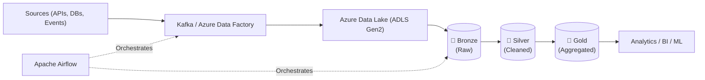

# 🚀 Coplur Data Engineering Internship Notes

  <b>A curated, production-focused collection of notes, architecture blueprints, and case studies from the Coplur Data Engineering Internship.</b>

---

## 🏗️ Architecture Blueprint

---

## 📚 Modules & Notes Directory

| Domain | Topics Covered | Session Notes & Documents |
|:---|:---|:---|
| 🐍 **Python Core** | String Formatting, Lists, Functions, File I/O, REST APIs | [Part 1](./Python1.pdf) • [Part 2](./Python2.pdf) • [Part 3](./Python3.pdf) • [Part 4](./Python4.pdf) • [Part 5](./Python5.pdf) • [Part 6](./Python6.pdf) |
| 📊 **NumPy** | 1D/3D Arrays, Tensor Shapes, Indexing, Vectorization, Modules | [Day 1](./NumPy%201.pdf) • [Day 2](./NumPy%202.pdf) • [Day 3](./NumPy%203.pdf) • [Day 4](./NumPy%204.pdf) • [Day 5](./NumPy%205.pdf) |
| 🐼 **Pandas** | DataFrames, Series, Analytics, Missing Data Handling | [Day 1](./Pandas1.pdf) • [Day 2](./Pandas2.pdf) • [Day 3](./Pandas3.pdf) |
| 🗄️ **SQL & Optimization** | RDBMS Basics, Joins, Window Functions, CTEs, Indexing | [Session 1](./SQL%20Session%201.pdf) • [Session 2](./SQL%20Session%202.pdf) • [Advanced SQL](./Advance%20SQL%20Notes.pdf) |
| ⚡ **Apache Spark** | Master-Worker Architecture, RDDs, DataFrames, Tuning, E-Commerce Case Study | [Session 1](./Spark%20Session%201.pdf) • [Session 2](./Spark%20Session%202.pdf) • [Session 3(i)](./Spark%20Session%203%28i%29.pdf) • [Session 3(ii)](./Spark%20Session%203%28ii%29.pdf) • [Session 4](./Spark%20Session%204.pdf) • [Case Study](./Spark%20Case%20Study.pdf) |
| 🧱 **Databricks & Lakehouse** | Workspace Setup, PySpark Compute, Delta Lake ACID, Medallion Architecture, Optimization | [Deck (PPTX)](./Data%20Bricks%201.pptx) • [Session 2](./Data%20Bricks%202.pdf) • [Session 3](./Data%20Bricks%203.pdf) • [Session 4](./Data%20Bricks%204.pdf) • [Session 5](./Data%20Bricks%205.pdf) |
| 📡 **Streaming (Kafka)** | Event Streaming, Topics, Partitions, Spark Streaming & Real-Time Fraud Detection | [Session 1](./Kafka%20Session%201.pdf) • [Session 2](./Kafka%20Session%202.pdf) • [Session 2 Revised](./Kafka%20Session%202%20Revised.pdf) |
| ☁️ **Cloud & Orchestration** | Azure Data Lake (ADLS Gen2), Azure Data Factory (ADF), Apache Airflow DAGs | [ADLS Gen2](./Azure%20Session%201.pdf) • [ADF ETL](./Azure%20Session%202.pdf) • [Airflow DAGs](./Airflow%20Session%201.pdf) |
| 🐳 **DevOps & Tooling** | Containerization with Docker Compose, Git & GitHub Collaboration Workflows | [Docker](./Docker%201.pdf) • [Git & GitHub](./Git%20Notes%201.pdf) |
| 📋 **Syllabus** | Master day-wise internship training curriculum and roadmap | [Curriculum Roadmap](./content.pdf) |

---

## 💡 Core Highlights

- **Medallion Architecture**: Hands-on Lakehouse design traversing **Bronze** (raw ingestion) $\rightarrow$ **Silver** (cleaned/filtered) $\rightarrow$ **Gold** (aggregated star schema).
- **Big Data Scale**: Distributed transformations, partitioning strategies (`repartition` vs `coalesce`), and shuffle tuning with PySpark.
- **Real-Time Streaming**: End-to-end event-driven architecture pairing Apache Kafka with Spark Structured Streaming for anomaly/fraud detection.
- **Enterprise Orchestration**: Automated end-to-end pipelines linking Azure Data Factory, Databricks jobs, and Apache Airflow DAG schedules.

---

## 👩‍💻 Author

**Khushboo Suwalka**  
*Data Engineering Intern @ Coplur*

⭐ *Star this repository if you find these notes helpful!* ⭐

